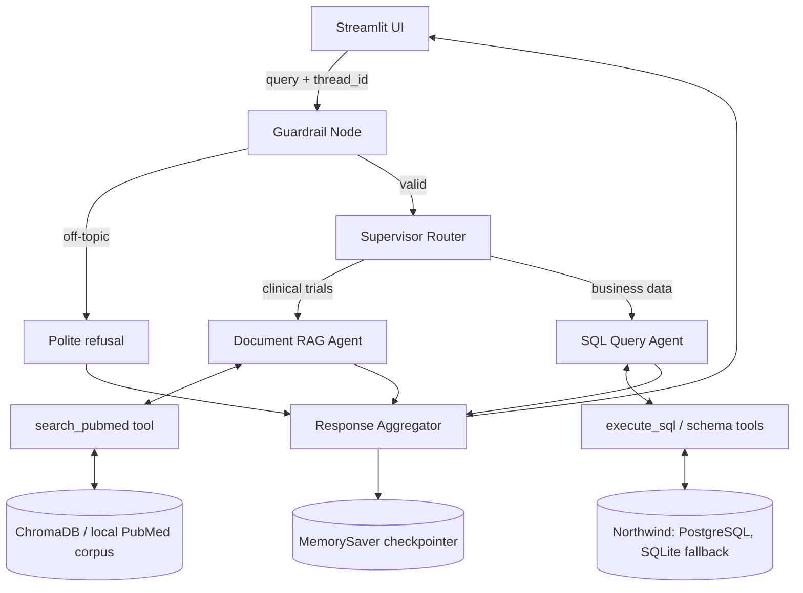

# Multi-Source Agentic Q&A Assistant with LangGraph

[](https://www.python.org/)
[](https://langchain-ai.github.io/langgraph/)
[](https://github.com/jlowin/fastmcp)
[](https://streamlit.io/)

A multi-agent question-answering assistant built with **LangGraph**, **FastMCP**, **ChromaDB**, the **Northwind** relational database and **Streamlit**.

The assistant reads each question, decides whether it concerns **clinical-trial literature** (PubMed documents, answered with RAG) or **business data** (Northwind, answered with generated SQL), and sends it to the matching sub-agent. Off-topic questions are rejected up front.

---

## Features

- **Guardrail node**: Rejects off-topic queries (recipes, weather, general trivia) at the graph entry point with a polite notice, so no LLM call is spent on them.
- **Supervisor router**: Classifies intent with an LLM, backed by a keyword-scoring heuristic, and routes to the RAG or SQL agent. It remembers the previous route to handle follow-up questions.
- **Document RAG agent**: Retrieves PubMed chunks from ChromaDB and writes a concise answer with inline numbered citations (`[1]`, `[2]`).
- **Hybrid retrieval**: Combines dense embeddings (`all-MiniLM-L6-v2`) with BM25-style keyword matching, merged by Reciprocal Rank Fusion, with a relevance threshold.
- **SQL query agent**: Reads the Northwind schema, generates a `SELECT` query, validates it, runs it, and shows the results as a dataframe. If a query fails, the agent feeds the error back to the LLM and retries (self-correction loop).
- **SQL safety guard**: `db_manager.py` validates generated SQL before execution and sanitizes the returned rows.
- **Database fallback**: Uses PostgreSQL first, and falls back to an in-memory SQLite copy of Northwind if the connection fails.
- **Conversation memory**: LangGraph `MemorySaver` checkpointer keyed by a session `thread_id`, so multi-turn conversations keep their context.
- **FastMCP tool server**: Exposes `search_pubmed_documents`, `execute_sql_query` and `get_database_schema` over the Model Context Protocol.
- **Streamlit UI**: Chat interface with agent badges (Document RAG Agent, SQL Query Agent, Guardrail Node), expandable citations and tabular results.
- **Multi-provider LLM support**: Uses Groq, Google Gemini or OpenAI, depending on which API key is set.

---

## Architecture



The graph in [graph.py](graph.py) has five nodes: `guardrail`, `supervisor`, `rag_agent`, `sql_agent` and `aggregator`. All of them share a single `AgentState` (query, route, retrieved documents, SQL and results, agent label, and conversation histories). See [Architecture.md](Architecture.md) for the full specification.

---

## Project Structure

```text
.
├── agents/
│   ├── __init__.py       # Exports rag_agent_node and sql_agent_node
│   ├── rag_agent.py      # Document RAG agent (retrieval + cited answer synthesis)
│   └── sql_agent.py      # SQL agent (generation, execution, self-correction)
├── tools/
│   ├── __init__.py
│   └── tools.py          # LangChain tool definitions (PubMed search, SQL, schema)
├── app.py                # Streamlit chat UI
├── graph.py              # LangGraph StateGraph and MemorySaver checkpointer
├── server.py             # FastMCP tool server
├── start.py              # Launches the FastMCP server and the Streamlit app together
├── vector_store.py       # ChromaDB hybrid search (dense + keyword, RRF)
├── db_manager.py         # PostgreSQL connection, SQLite fallback, SQL validation
├── schema.txt            # Northwind schema and PostgreSQL dialect notes for the SQL agent
├── Architecture.md       # Technical architecture specification
├── requirements.txt
└── .env.example
```

---

## Getting Started

### Prerequisites

- Python 3.10 or newer
- An API key for at least one LLM provider (Groq, Google Gemini or OpenAI)
- Optional: a local PostgreSQL server with the Northwind database. Without it, the app uses the built-in SQLite fallback.

### 1. Install

```bash
git clone <your-repo-url>
cd "Multi-Source Agentic Q&A Assistant with LangGraph"

python -m venv .venv
# Windows PowerShell
.venv\Scripts\Activate.ps1
# macOS / Linux
# source .venv/bin/activate

pip install -r requirements.txt
```

### 2. Configure

Copy the example environment file and fill in your values:

```bash
cp .env.example .env        # Windows PowerShell: Copy-Item .env.example .env
```

| Variable         | Description                                                      |
| :--------------- | :--------------------------------------------------------------- |
| `GROQ_API_KEY`   | Groq API key (checked first)                                     |
| `GOOGLE_API_KEY` | Google Gemini API key (used if no Groq key is set)               |
| `OPENAI_API_KEY` | OpenAI API key (used if neither of the above is set)             |
| `DB_URL`         | PostgreSQL connection string for the Northwind database          |
| `CHROMA_PATH`    | Directory of the ChromaDB vector store (default `./chroma_db`)   |

Provide at least one LLM key. Never commit your `.env` file. It is already listed in `.gitignore`.

### 3. Run

```bash
python start.py
```

This starts the FastMCP server (`server.py`) and the Streamlit app (`app.py`). Open <http://localhost:8501> in your browser.

To run the pieces separately:

```bash
python server.py                 # FastMCP tool server
streamlit run app.py             # Web UI
```

---

## Example Questions

| Question                                                  | Routed to        |
| :-------------------------------------------------------- | :--------------- |
| What were the main outcomes reported in the clinical trials? | Document RAG Agent |
| Which customers placed the most orders?                   | SQL Query Agent  |
| Show total sales per product category                     | SQL Query Agent  |
| What's the weather like today?                            | Guardrail Node (refused) |

---

## Tech Stack

| Layer              | Technology                                          |
| :----------------- | :-------------------------------------------------- |
| Orchestration      | LangGraph, LangChain                                |
| Tool protocol      | FastMCP                                             |
| Vector search      | ChromaDB, sentence-transformers (`all-MiniLM-L6-v2`) |
| Structured data    | Northwind on PostgreSQL (SQLAlchemy, psycopg2), SQLite fallback |
| LLM providers      | Groq, Google Gemini, OpenAI                         |
| Frontend           | Streamlit                                           |

---

## Notes

- The SQL agent only runs read-only `SELECT` queries. They are validated before execution.
- If the PostgreSQL connection fails, or a query fails because of column-name casing, the app retries against the in-memory SQLite database.
- Conversation memory lives in process memory (`MemorySaver`) and is lost when the app restarts.
